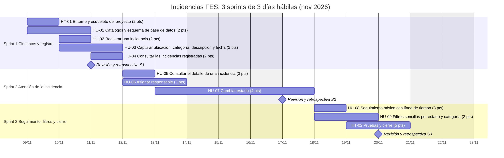

# Incidencias FES

Sistema web para **registrar, asignar y dar seguimiento a incidencias de infraestructura** de la facultad (HDMI que no funciona, contactos sin corriente, mobiliario dañado, etc.).

Proyecto escolar de Ingeniería de Software, desarrollado en **3 sprints de 3 días hábiles** con Scrum.

**Repositorio:** https://github.com/angugo06/incidencias-fes · **Avance:** [issues](https://github.com/angugo06/incidencias-fes/issues) y [tablero en GitHub Projects](https://github.com/users/angugo06/projects/2) (ver [docs/github.md](docs/github.md)).

| Capa | Tecnología |
|---|---|
| Cliente | React 18 + Vite + React Router |
| API | Node.js 22 + Express 5 |
| Base de datos | PostgreSQL 16 |
| Pruebas | `node:test` + supertest (API), Vitest + Testing Library (cliente) |

## Alcance

1. Registrar una incidencia.
2. Capturar ubicación, categoría, descripción y fecha.
3. Consultar las incidencias registradas.
4. Asignar una incidencia a un responsable.
5. Cambiar el estado de una incidencia.
6. Consultar el detalle y un seguimiento básico.
7. Filtros sencillos por estado o categoría.

Queda **fuera**: inicio de sesión y roles, fotos, correos, reportes y administración de catálogos (ver [decisiones](contexto/DECISIONES.md)).

## Puesta en marcha (resumen)

Requisitos: Node.js 20 o superior y PostgreSQL 16 (se puede usar Docker). Guía paso a paso para Windows: [docs/instalacion.md](docs/instalacion.md).

```bash
cp .env.example .env     # configuración (copia el archivo)
docker compose up -d     # levanta PostgreSQL (o usa uno propio y ajusta .env)
npm run setup            # instala dependencias de raíz, server y client
npm run db:demo          # crea las tablas y carga datos de ejemplo
npm run dev              # API en :3001 y cliente en http://localhost:5173
```

Pruebas: `npm test` (la API necesita PostgreSQL con la BD `incidencias_test`).

## Estructura

```
incidencias/
├── client/      React (pantallas, API del cliente, estilos)
├── server/      Express (rutas, validación, reglas de estado, pruebas)
├── db/          schema.sql, seed.sql, seed_demo.sql
├── docs/        requisitos, guía, arquitectura, API, BD, sprints, Gantt
├── contexto/    estado, decisiones y convenciones para continuar el proyecto
├── tools/       generador del plan (plan.json) y prueba de punta a punta
├── CLAUDE.md    punto de entrada del contexto permanente
└── CONTEXT.md   mapa: a dónde ir según la tarea
```

## Documentación

| Documento | Contenido |
|---|---|
| [docs/requisitos.md](docs/requisitos.md) | Requisitos funcionales, no funcionales y reglas de negocio |
| [docs/guia-usuario.md](docs/guia-usuario.md) | Cómo usar el sistema, con capturas |
| [docs/arquitectura.md](docs/arquitectura.md) | Capas, flujo de una petición, decisiones técnicas |
| [docs/api.md](docs/api.md) | Referencia de la API REST |
| [docs/base-de-datos.md](docs/base-de-datos.md) | Modelo, tablas y restricciones |
| [docs/instalacion.md](docs/instalacion.md) | Instalación y solución de problemas |
| [docs/pruebas.md](docs/pruebas.md) | Estrategia y cobertura de pruebas |
| [docs/sprints/](docs/sprints/resumen.md) | Plan de cada sprint con historias, tareas, puntos y horas |
| [docs/gantt.md](docs/gantt.md) | Diagrama de Gantt (Mermaid + imagen) |
| [docs/backlog.csv](docs/backlog.csv) | Backlog completo (historias y tareas) |
| [docs/github.md](docs/github.md) | Issues, etiquetas y GitHub Project ligados al plan |
| [contexto/](contexto/ESTADO.md) | Estado actual, decisiones, convenciones y glosario |

## Planeación

30 puntos y 60 horas en 11 historias (10 puntos y 20 horas por sprint) (2 técnicas y 9 de usuario).


