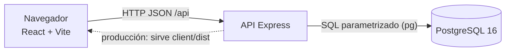

# Arquitectura

## Vista general



Tres capas, sin servicios intermedios:

| Capa | Carpeta | Responsabilidad |
|---|---|---|
| Presentación | `client/` | Pantallas, formularios, validación rápida en el navegador |
| Aplicación | `server/` | Rutas REST, validación definitiva, reglas de estado, transacciones |
| Datos | `db/` | Esquema, restricciones, catálogos |

El servidor es quien manda: toda regla importante se valida en la API y, si aplica, también en la BD (`CHECK`, llaves foráneas).

## Estructura del servidor

```
server/src/
├── server.js        arranque (puerto, pool)
├── app.js           crea Express: JSON, rutas, cliente estático, errores
├── config.js        variables de entorno
├── db.js            pool de pg (DATE como texto)
├── errores.js       ErrorApi y formato único de error
├── estados.js       ciclo de vida: transiciones permitidas
├── validacion.js    validación de cuerpos y filtros
├── bd/reiniciar.js  borra/crea esquema y carga seeds
└── rutas/
    ├── catalogos.js     GET /api/catalogos
    └── incidencias.js   registrar, listar, detalle, asignar, estado, comentar
```

`crearApp(pool)` recibe el pool, así las pruebas usan otra BD sin cambiar código.

## Estructura del cliente

```
client/src/
├── main.jsx / App.jsx     arranque, layout y rutas
├── api.js                 fetch a /api, ErrorApi con detalles por campo
├── formato.js             etiquetas y fechas
├── componentes/           InsigniaEstado, Aviso
└── paginas/               ListaIncidencias, NuevaIncidencia, DetalleIncidencia
```

Rutas del cliente: `/` (lista con filtros en la URL), `/nueva`, `/incidencias/:id`.

## Flujo de una petición (asignar)

```mermaid
sequenceDiagram
  participant C as Cliente
  participant R as rutas/incidencias.js
  participant V as validacion.js / estados.js
  participant B as PostgreSQL
  C->>R: PATCH /api/incidencias/7/asignacion {responsable_id: 2}
  R->>V: validar cuerpo y estado
  R->>B: BEGIN; SELECT ... FOR UPDATE
  R->>B: UPDATE incidencias; INSERT seguimiento
  R->>B: COMMIT
  R-->>C: 200 detalle completo actualizado
```

## Decisiones técnicas clave

| Tema | Decisión | Motivo |
|---|---|---|
| Concurrencia | `SELECT … FOR UPDATE` dentro de transacción | Evita dos cambios simultáneos sobre la misma incidencia |
| Respuestas | Cada escritura devuelve el detalle completo | El cliente se refresca sin pedir de nuevo |
| Acciones permitidas | El servidor envía `transiciones_permitidas` y `puede_asignar` | El cliente no duplica reglas |
| Seguimiento | Tabla única de eventos | Una sola línea de tiempo ordenada |
| Fechas | `DATE` como texto `AAAA-MM-DD` | Sin desfases por zona horaria |
| Estilos | CSS propio, sin librerías | Menos dependencias para un proyecto chico |

Más en [contexto/DECISIONES.md](../contexto/DECISIONES.md).

## Seguridad

- SQL siempre parametrizado; filtros validados con lista blanca/regex.
- React escapa el texto: la descripción no ejecuta HTML.
- Sin autenticación (ADR-002): publicar solo dentro de una red de confianza.
