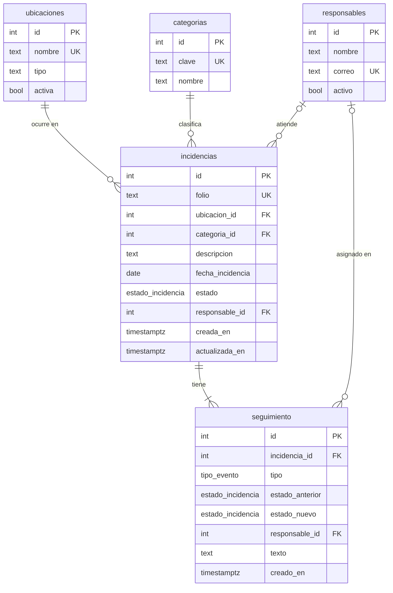

# Base de datos

PostgreSQL 16. Fuente de verdad: [`db/schema.sql`](../db/schema.sql). Datos base: [`db/seed.sql`](../db/seed.sql); demo opcional: [`db/seed_demo.sql`](../db/seed_demo.sql).

## Diagrama

## Tipos

| Tipo | Valores |
|---|---|
| `estado_incidencia` | `nueva`, `asignada`, `en_proceso`, `resuelta` |
| `tipo_evento` | `registro`, `asignacion`, `estado`, `comentario` |

## Tablas

| Tabla | Para qué | Notas |
|---|---|---|
| `ubicaciones` | Catálogo de lugares | `activa=false` oculta la ubicación al registrar pero conserva el historial |
| `categorias` | Catálogo de categorías | `clave` se usa en el filtro de la API |
| `responsables` | Personal de mantenimiento | `activo` controla si se puede asignar |
| `incidencias` | Registro principal | Ver restricciones abajo |
| `seguimiento` | Línea de tiempo | `ON DELETE CASCADE` con la incidencia |

## Restricciones importantes

| Restricción | Garantiza |
|---|---|
| `folio` con `DEFAULT` desde `folio_seq` | Folio `INC-AAAA-NNNN` consecutivo y único |
| `CHECK (char_length(btrim(descripcion)) >= 10)` | Descripción mínima aun si alguien salta la API |
| `estado_vs_responsable`: `(estado='nueva') = (responsable_id IS NULL)` | `nueva` ⇔ sin responsable |
| Llaves foráneas a catálogos | No hay ubicación, categoría ni responsable inexistentes |

El folio usa un consecutivo global (no se reinicia cada año) y puede tener huecos si una inserción falla.

## Índices

| Índice | Uso |
|---|---|
| `idx_incidencias_estado` | Filtro por estado |
| `idx_incidencias_categoria` | Filtro por categoría |
| `idx_incidencias_creada` | Orden de la lista |
| `idx_seguimiento_incidencia (incidencia_id, creado_en)` | Línea de tiempo |

## Operación

| Comando | Efecto |
|---|---|
| `npm run db:init` | Borra el esquema `public`, crea tablas y carga catálogos |
| `npm run db:demo` | Lo anterior + 6 incidencias de ejemplo |

Ambos son destructivos; úsalos solo en desarrollo.

## Catálogos iniciales

- **Ubicaciones (10):** talleres de cómputo y de electrónica, auditorio, canchas de fútbol y de basquetbol, explanada, librería, biblioteca, cafetería, salones (edificio A).
- **Categorías (5):** eléctrica, audiovisual, mobiliario, limpieza, otra.
- **Responsables (3):** datos de ejemplo con correos `.example`.
