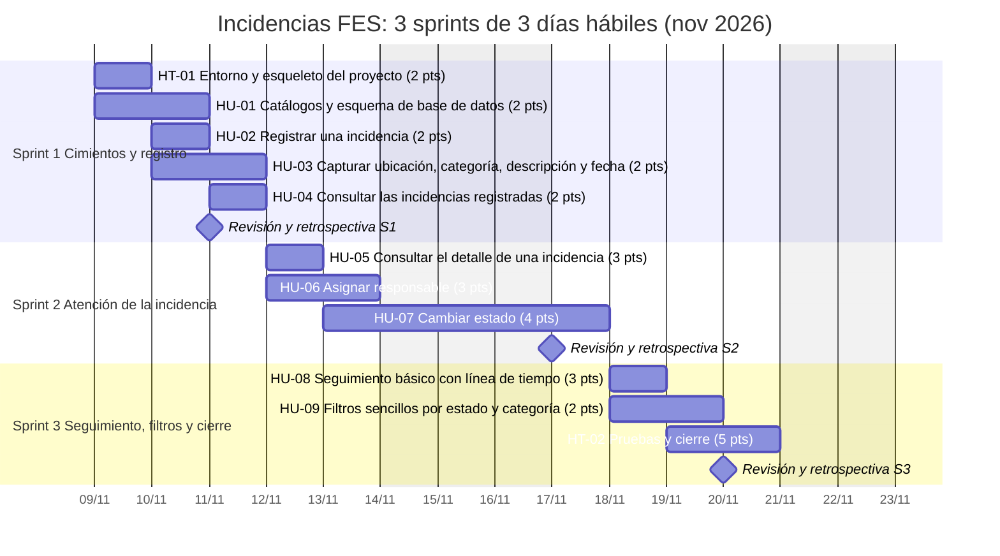
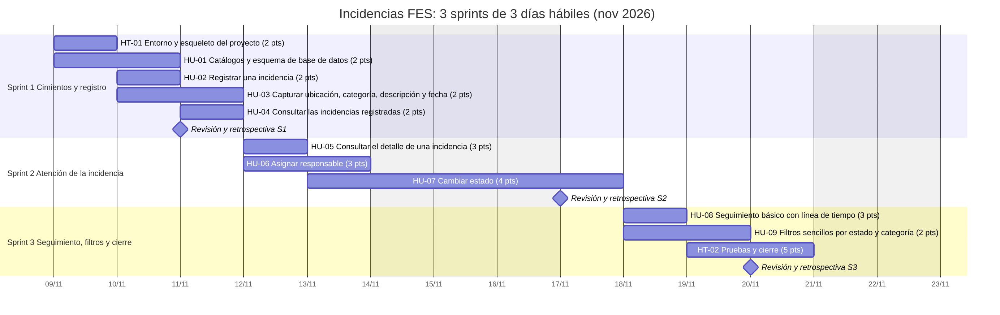

# Diagrama de Gantt

Calendario de los 3 sprints (3 días hábiles cada uno, 7 h productivas por día). El 16 de noviembre es feriado y se excluye.
Las historias de cada sprint van en secuencia; una historia puede compartir día con la anterior. El archivo fuente es `gantt.mmd`.

| Sprint | Fechas | Meta | Historias | Puntos | Horas |
|---|---|---|---|---:|---:|
| [1 — Cimientos y registro](sprints/sprint-1.md) | 09/11–11/11 | Poder registrar una incidencia con sus datos y verla en una lista. | HT-01, HU-01, HU-02, HU-03, HU-04 | 10 | 20 |
| [2 — Atención de la incidencia](sprints/sprint-2.md) | 12/11–17/11 | Consultar el detalle, asignar un responsable y llevar la incidencia por sus estados. | HU-05, HU-06, HU-07 | 10 | 20 |
| [3 — Seguimiento, filtros y cierre](sprints/sprint-3.md) | 18/11–20/11 | Seguimiento con comentarios, filtros por estado y categoría, pruebas y documentación final. | HU-08, HU-09, HT-02 | 10 | 20 |
| **Total** | | | 11 | 30 | 60 |
