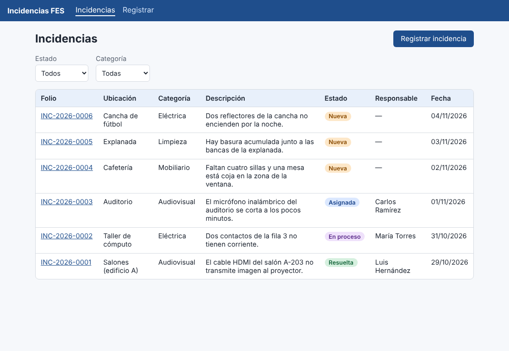
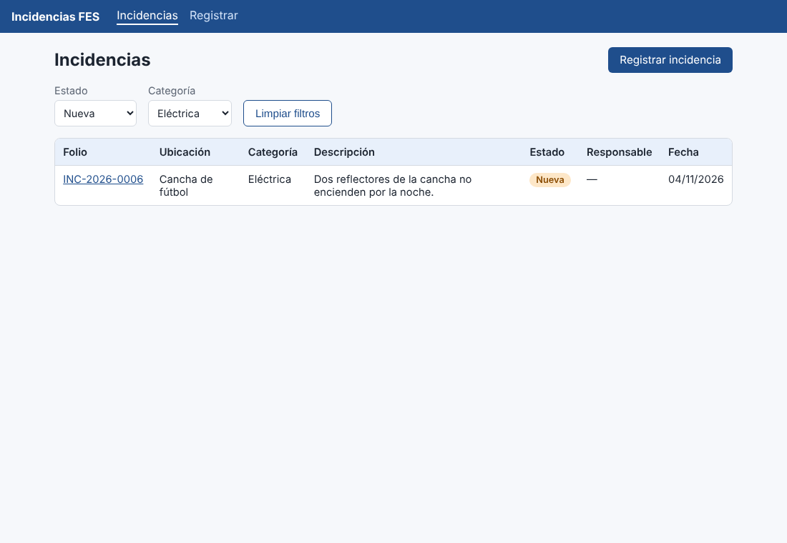
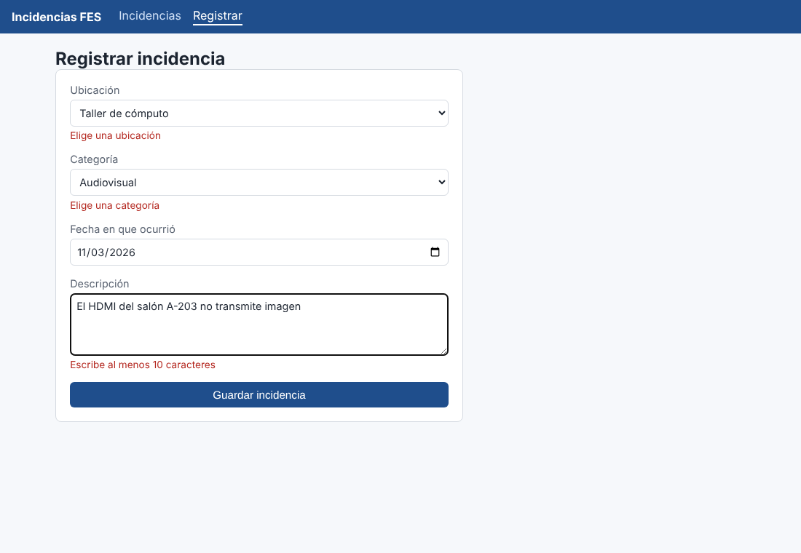
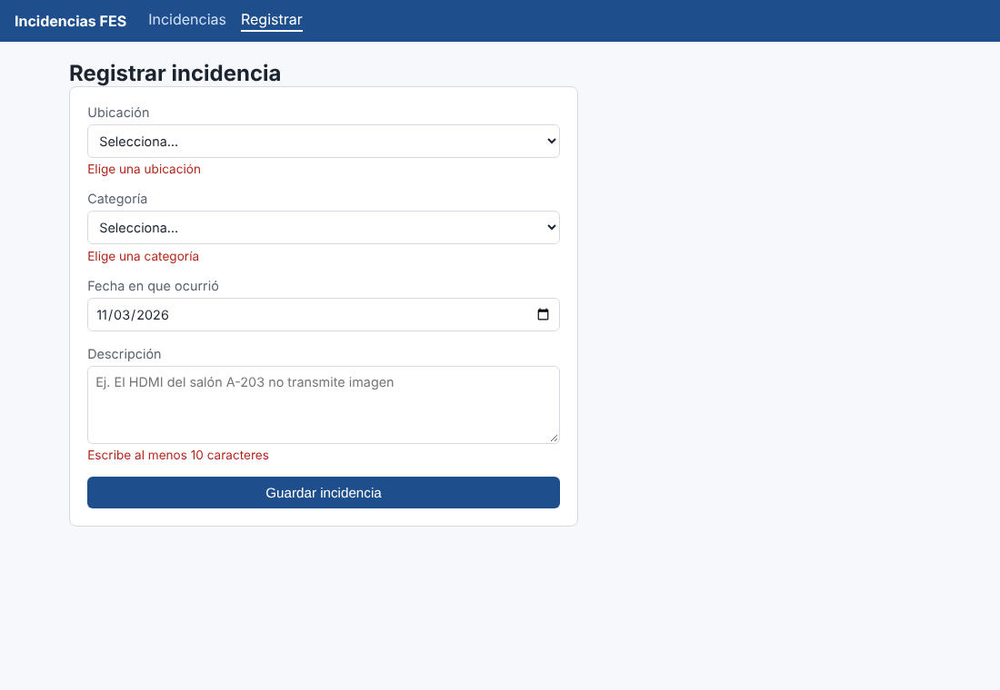
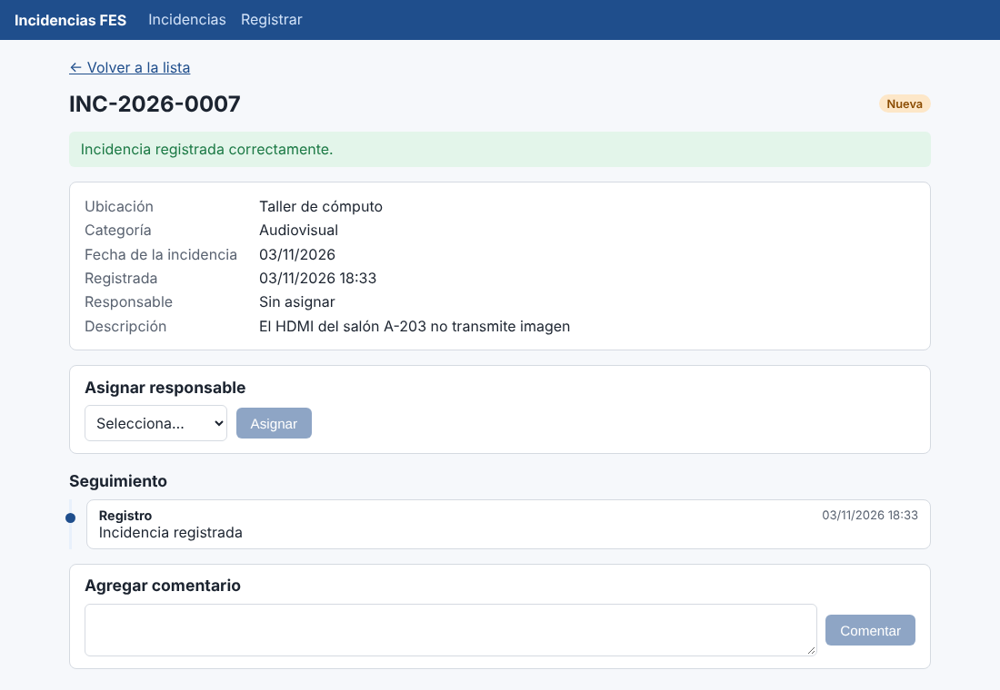
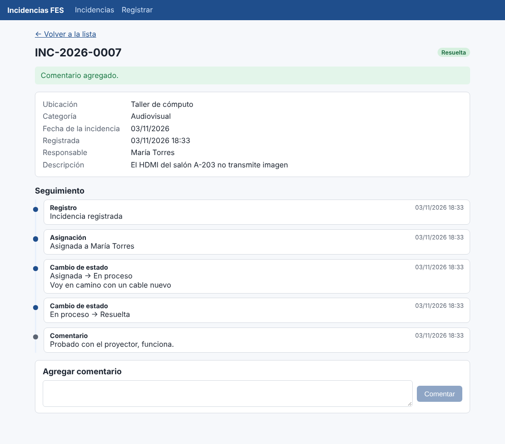

# Guía de usuario

## Pantallas

La barra superior tiene dos enlaces: **Incidencias** (lista) y **Registrar**.

### 1. Ver las incidencias

La lista muestra folio, ubicación, categoría, descripción, estado, responsable y fecha, de la más reciente a la más antigua. Haz clic en un folio para abrir su detalle.

Colores de estado: **Nueva** (naranja), **Asignada** (azul), **En proceso** (morado), **Resuelta** (verde).

### 2. Filtrar

Elige un **estado**, una **categoría** o ambos. La lista se actualiza sola y la dirección web guarda los filtros (puedes copiarla para compartir la vista). «Limpiar filtros» los quita.

### 3. Registrar una incidencia

Entra a **Registrar** y llena:

| Campo | Qué poner |
|---|---|
| Ubicación | Lugar del problema (lista) |
| Categoría | Eléctrica, audiovisual, mobiliario, limpieza u otra |
| Fecha en que ocurrió | Por defecto hoy; no puede ser futura |
| Descripción | Qué pasa, mínimo 10 caracteres |

Si falta algo, el formulario lo señala debajo del campo y no guarda:

Al guardar, el sistema abre el detalle con la confirmación y el **folio** (por ejemplo `INC-2026-0007`). Anótalo para dar seguimiento.

### 4. Asignar un responsable

En el detalle de una incidencia **nueva** (o ya asignada) aparece el panel **Asignar responsable**. Elige a la persona y pulsa **Asignar**; el estado pasa a *Asignada*. Mientras no empiece el trabajo se puede **reasignar**.

### 5. Cambiar el estado

Con la incidencia asignada, el panel **Cambiar estado** ofrece solo el siguiente paso:

1. **Iniciar trabajo** → *En proceso*.
2. **Marcar como resuelta** → *Resuelta* (estado final).

Puedes escribir una nota opcional antes de pulsar el botón (por ejemplo, qué se hizo).

### 6. Seguimiento y comentarios

La sección **Seguimiento** es la historia completa: registro, asignaciones, cambios de estado y comentarios, con fecha y hora. Para agregar un comentario escríbelo y pulsa **Comentar**.

## Mensajes de error comunes

| Mensaje | Qué significa |
|---|---|
| «Elige una ubicación / categoría» | Falta seleccionar la opción |
| «Escribe al menos 10 caracteres» | Descripción demasiado corta |
| «La fecha no puede ser futura» | Usa hoy o una fecha pasada |
| «No se pudo conectar con el servidor» | La API no está activa; avisa al equipo técnico |
| «No se puede pasar de … a …» | Ese cambio de estado no está permitido |
